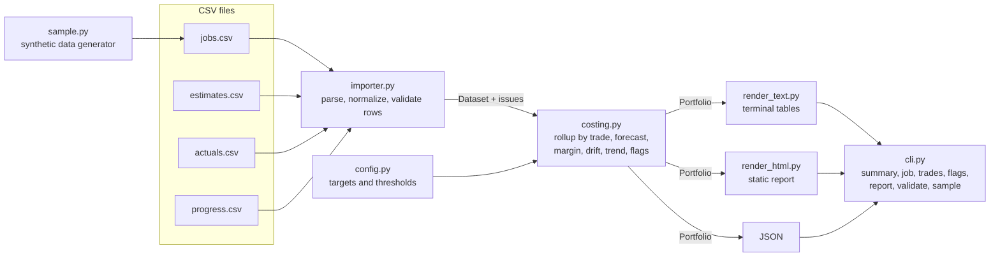

# job-costing

Small contractors price a job on an estimate, then find out at the final invoice whether it made money.
This tool compares estimate to actual cost by trade while the job is still open, and flags the jobs whose margin is sliding below target.

## What it does

- Imports four CSV files: jobs, estimate lines, actual cost entries (labor hours, materials, subs) and optional percent-complete reports.
- Validates every row. Bad rows are skipped and listed with file and line number, so one typo does not block the report.
- Rolls cost up by trade and by cost type, per job and across all jobs.
- Forecasts cost at completion per trade, then computes estimated margin, projected margin and drift (the gap between them, in margin points).
- Replays history at each progress report date to get a margin trend, and flags each job:
  - `BELOW`: projected (or final) margin is under target.
  - `TRENDING`: still above target, but the recent slope carries it under target by completion.
  - `WATCH`: above target but within 3 points of it.
  - `OK`: everything else.
- Outputs terminal tables, JSON, and a single self-contained HTML report (inline CSS and SVG, no scripts, no network).

Pure Python standard library. No database, no services, no API keys. All data in this repo is synthetic.

## Architecture



## Run it

Needs Python 3.10 or newer. Nothing to install.

```
python -m jobcost summary
python -m jobcost flags
python -m jobcost report --out report.html
```

All commands read `data/sample` by default. Point them at your own folder with `--data path/to/folder`.

Other commands and options:

| Command | Purpose |
| --- | --- |
| `python -m jobcost job J-103` | Trade-level detail, cost types, margin history and reasons for one job |
| `python -m jobcost trades` | Estimate versus forecast by trade across all jobs, worst overrun first |
| `python -m jobcost validate` | List the CSV rows that would be skipped (exit code 1 if any) |
| `python -m jobcost sample --out data/sample` | Regenerate the synthetic data set |
| `--target 35` | Default target margin for this run |
| `--as-of 2026-08-21` | Ignore actuals and progress after a date, to see what the report said then |
| `--strict` | Fail instead of skipping bad rows |
| `--json` | Machine-readable output (summary, job, flags) |
| `flags --fail-on-flag` | Exit code 2 when any job is flagged, for use in a scheduled check |

Thresholds can also be set with environment variables or a `.env` file. See `.env.example`.

## CSV format

Header names are case-insensitive and spaces are treated as underscores. Money accepts `1234.5`, `$1,234.50` and `(85.00)` for a credit. Dates are `YYYY-MM-DD` or `MM/DD/YYYY`.

| File | Columns (optional in brackets) |
| --- | --- |
| `jobs.csv` | `job_id, name, contract_amount, [status], [target_margin_pct]` |
| `estimates.csv` | `job_id, trade, cost_type, [description], [quantity], [unit_cost], [amount]` |
| `actuals.csv` | `job_id, date, trade, cost_type, [description], [hours], [rate], [amount], [vendor]` |
| `progress.csv` (optional) | `job_id, trade, as_of, percent_complete` |

- `cost_type` is `labor`, `material` or `sub`.
- An estimate line needs `amount`, or `quantity` and `unit_cost`. For labor lines, `quantity` is hours.
- A labor actual may leave `amount` blank and give `hours` and `rate`.
- `status` is `active` or `complete`. Percent values are in percent units (`35` means 35%).

## How the numbers are computed

Forecast cost at completion, per trade:

| Situation | Forecast | Method label |
| --- | --- | --- |
| Job is complete | actual cost | `final` |
| Trade reported 100% | actual cost | `complete` |
| Trade reported 15% or more | actual / percent complete | `earned-value` |
| Trade reported under 15% | actual + estimate x (1 - percent complete) | `early` |
| No progress reported | the greater of estimate and actual | `no-progress` |

Then, per job:

- estimated margin = (contract - estimate) / contract
- projected margin = (contract - forecast) / contract
- drift = projected margin - estimated margin
- trend = least-squares slope of projected margin against job percent complete over the last 4 progress snapshots (needs at least 3 snapshots spanning 10 points of progress); trend margin = projected margin + slope x remaining progress

A per-job `target_margin_pct` in `jobs.csv` wins over the default target (`--target`, then `JOBCOST_TARGET_MARGIN`, then 35%).

## Tests

```
python -m pip install -r requirements-dev.txt
python -m pytest
```

51 tests cover parsing, row validation, each forecast method, margin and drift arithmetic, the trend and every flag status, the CLI exit codes and the HTML report. CI (`.github/workflows/ci.yml`) runs the tests and the demo on Python 3.10, 3.12 and 3.13.

## Demo

```
python demo/run_demo.py
```

The demo runs every view against the synthetic data in `data/sample` (seven invented jobs, one for each outcome), plus a deliberately messy export in `demo/messy`. It is fully offline. The captured transcript is in [`demo/output.txt`](demo/output.txt) and the generated report is [`demo/report.html`](demo/report.html).

Excerpt:

```
Job    Name                         Done  Contract  Estimate    Actual  Forecast  Est mgn  Proj mgn  Drift  Target    Status
-----  -------------------------  ------  --------  --------  --------  --------  -------  --------  -----  ------  --------
J-102  Sample Bath Remodel           77%   $20,900   $12,952   $12,086   $15,532    38.0%     25.7%  -12.3     35%     BELOW
J-105  Sample Rental Turnover     closed   $17,850   $11,250   $13,019   $13,019    37.0%     27.1%   -9.9     35%     BELOW
J-103  Sample Basement Finish        64%   $66,250   $39,760   $27,187   $41,840    40.0%     36.8%   -3.1     35%  TRENDING
J-107  Sample Window Replacement     72%   $29,750   $18,756   $13,527   $18,786    37.0%     36.9%   -0.1     35%     WATCH
J-101  Sample Kitchen Remodel        67%   $59,750   $35,246   $23,160   $34,906    41.0%     41.6%   +0.6     35%        OK

[TRENDING] J-103 Sample Basement Finish: projected 36.8% vs target 35% (estimated 40.0%, drift -3.1 pts)
    - Projected margin 36.8% is still above the 35.0% target but is moving -0.7 points per 10% of progress; on that trend the job finishes near 34.2%.
    - Drywall: forecast 12% over estimate (+$1,031).
```

## Where this pattern runs

This is drawn from systems that run two small service companies day to day, where estimates, timesheets, supplier bills and sub invoices live in different tools and the weekly question is simply which open jobs are losing margin and which trade is causing it. The code here is a clean rewrite of that pattern with invented data.

## Limitations

- Revenue is the contract amount in `jobs.csv`. Change orders are not modeled; update the contract amount (and add estimate lines) by hand when one is approved.
- Percent complete is whatever the field reports. A generous progress report makes a trade look healthier than it is, and the earned-value forecast inherits that error.
- Trades with no progress report are forecast at the greater of estimate and actual, which hides an overrun until actual cost passes the estimate.
- The trend is a straight line through at most four snapshots, extended across the rest of the job, including trades that have not started. It is an early warning to go look, not a prediction.
- Costs are what has been entered. Committed but unbilled cost (open purchase orders, sub work not yet invoiced) is invisible.
- No overhead allocation, retainage, tax or billing. Margin here is gross margin on direct job cost.
- Labor cost is hours times the rate on the entry. There is no burden calculation; use a burdened rate.
- A job marked `complete` is treated as final even when `--as-of` points at an earlier date.
- Trade names are matched after lowercasing and trimming. "Plumbing" and "plumbing rough-in" are two trades.
- Everything is held in memory and recomputed per run. That is fine for thousands of rows, not for millions.
- The HTML report has been checked by tests for structure and escaping, not across browsers.

License: MIT, see the LICENSE file.
